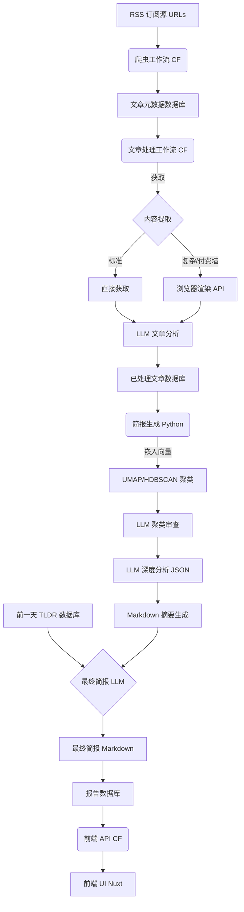

# Meridian: 你的个人情报机构

[English](./README.md) | [简体中文](./README.zh-CN.md)

[](https://github.com/iliane5/meridian/actions/workflows/deploy-services.yaml)
[](https://opensource.org/licenses/MIT)

**总统级情报简报，由 AI 构建，为你量身定制。**

Meridian 通过抓取数百个新闻源，使用 AI 分析新闻故事，并提供简洁、个性化的每日简报，帮助你穿透新闻噪音。

<p align="center">
  
</p>

## 为什么存在

总统们每天都会收到量身定制的情报简报。现在有了 AI，你也可以。Meridian 提供：

- 按相关性筛选的关键全球事件
- 背景和潜在驱动因素
- 影响分析
- 开源透明

专为那些渴望超越标题深度但又没有时间投入的好奇者而构建。

## 核心特性

- **信息源覆盖**：数百个多样化的新闻源
- **AI 分析**：多阶段 LLM 处理（Gemini）用于文章和聚类分析
- **智能聚类**：嵌入向量 + UMAP + HDBSCAN 将相关文章分组
- **个性化简报**：具有分析性语气和连续性跟踪的每日简报
- **Web 界面**：简洁的 Nuxt 3 前端

## 工作原理



1. **抓取**：Cloudflare Workers 获取 RSS 订阅源，存储元数据
2. **处理**：提取文本，使用 Gemini 分析相关性和结构
3. **简报生成**：聚类文章，生成分析，综合最终简报
4. **前端**：通过 Nuxt/Cloudflare 显示简报

## 技术栈

- **基础设施**：Turborepo、Cloudflare（Workers、Workflows、Pages）
- **后端**：Hono、TypeScript、PostgreSQL、Drizzle
- **AI/ML**：Gemini 模型、multilingual-e5-small 嵌入向量、UMAP、HDBSCAN
- **前端**：Nuxt 3、Vue 3、Tailwind

## 安装配置

**前置要求**：Node.js v22+、pnpm v9.15+、Python 3.10+、PostgreSQL、Cloudflare 账户、Google AI API 密钥

```bash
git clone https://github.com/iliane5/meridian.git
cd meridian
pnpm install
# 配置 .env 文件
pnpm --filter @meridian/database migrate
# 通过 Wrangler 部署，手动运行 Python 简报 notebook
```

## 状态与下一步

- ✅ **核心管道**：抓取、处理、分析正常运行
- ⏳ **首要任务**：自动化简报生成（目前是手动 Python notebook）
- ⚠️ **监控**：提高抓取的稳健性
- 🔜 **未来**：添加测试、newsletter 分发

## AI 协作

这个项目从 AI 辅助中获益良多：

- **Claude 3.7 Sonnet**：参与了早期架构头脑风暴，生成了浏览器 js 爬虫脚本，优化了提示词，并在我过度思考或过度设计时及时指出。
- **Gemini 2.5 Pro**：在长上下文任务中表现出色 - 比较不同提示词变体的输出，在开源前审查整个代码库，并为简报确定了准确的分析语气。
- **Gemini 2.0 Flash**：这个项目真正的无名英雄 - 极快的速度，极低的成本，在提示词得当时出奇地强大。它是使运行 Meridian 在经济上可行的主力，无需赞助商或拨款。本质上是大规模的免费情报。

前两者将数月的开发工作压缩到几天，并使构建过程更加有趣。但 Flash 不仅仅是节省时间的工具——它是使 Meridian 成为可能的引擎。没有人类每天阅读 2000+ 篇文章并分析 100+ 个新闻聚类。有 AI 同伴进行头脑风暴感觉像是作弊；有 AI 工作者处理实际的情报管道感觉像是生活在未来。

## 许可证

MIT License - 详见 [LICENSE](./LICENSE) 文件。

---

_构建这个项目，是因为我们生活在一个魔法时代，却总是忘记使用它。_
